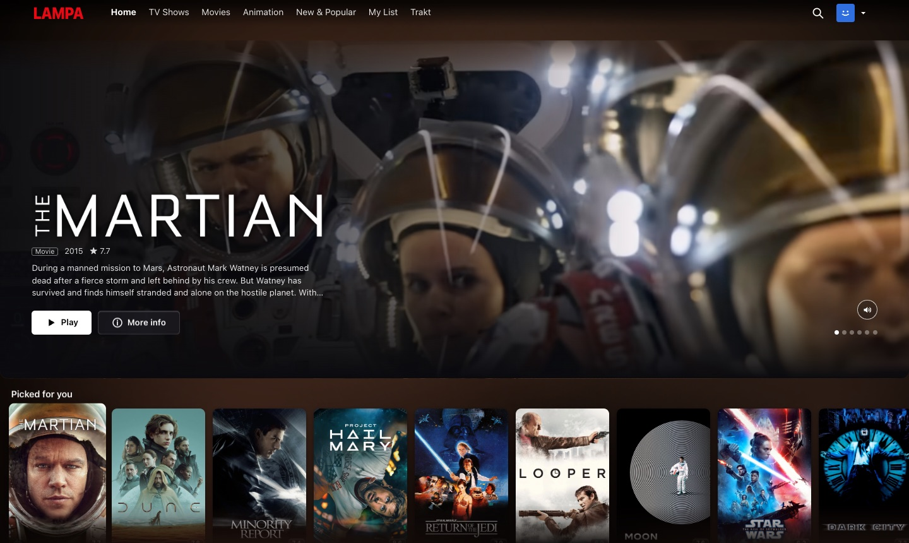
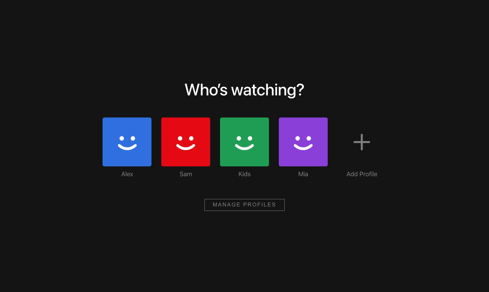
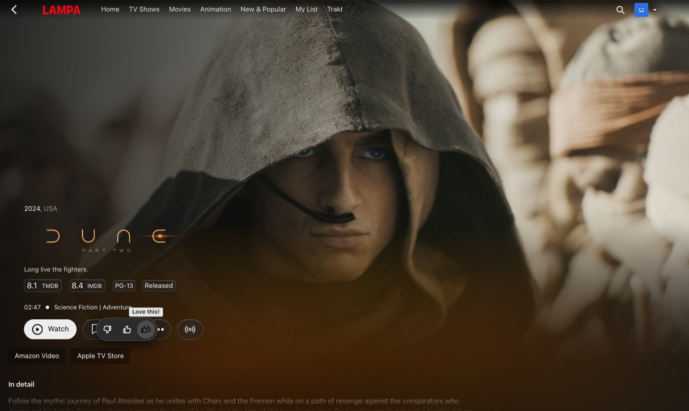
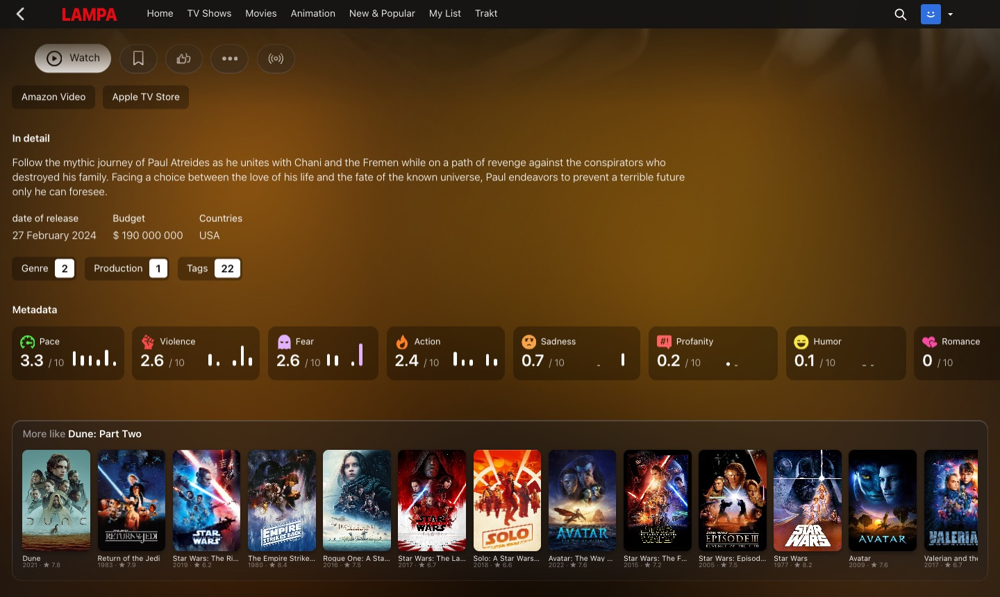
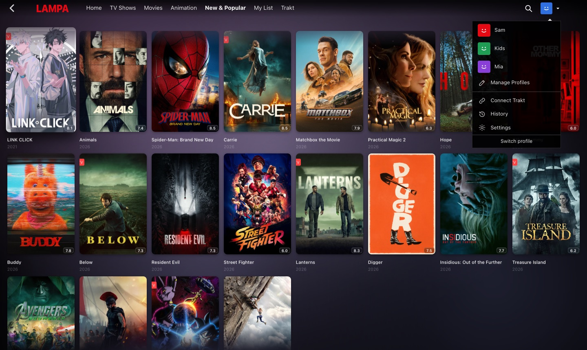

# Lampa Desktop

**[Lampa](https://github.com/yumata/lampa) on a computer, styled like a streaming service.** Lampa is a free
TV-first app for browsing films and series and playing them through TorrServer. Its web version looks and
feels like a TV app on a laptop: huge type, a remote-control header, rows that move one card at a time.
This fork keeps Lampa as it is (apart from five small fixes to its search, episode list and HLS subtitles, listed in
[desktop/README.md](desktop/README.md)) and adds a desktop layer on top: Netflix-style profiles and navigation, a
personal Home that learns from thumbs ratings, full-screen trailers, Apple TV-style dark glass and sharp
artwork.

## What it adds

**Profiles, like Netflix.** "Who's watching?" on the first visit, up to ten profiles, each with its own
avatar colour. Every profile has its own My List, watch history and progress, search history, thumbs
ratings and Trakt account, so one person's taste never shows up in another's Home. Switch profiles from
the avatar menu in the top bar.

**Thumbs ratings that teach the recommendations.** Every title page has *Not for me / I like this /
Love this!*. "Picked for you" at the top of Home and the featured billboard are built from them: titles
related to what you liked (Trakt's related titles, which are much better than TMDB's), with loves counting
double and dislikes pushing similar titles down. With Trakt connected, ratings are sent to Trakt (3, 7 or
10 out of 10), Trakt's own recommendations join in, and ratings already on Trakt (an imported IMDb history,
for example) count as thumbs.

**Title pages as a full-screen hero.** The backdrop fills the screen and the trailer fades in over it,
with the title's logo, details and buttons over a dark gradient. Trailers play with sound when the browser
allows it, get English subtitles when they're in another language, and stop as soon as you scroll, switch
tab or press Play. Only three buttons: Play (or Resume, with "S2 E5 · 26 min left" under the ratings), + My
List and the thumbs. Series list their episodes as on Netflix: a season picker, then every episode with its
picture, length, what happens and how much you've watched. At the bottom of each page: "More like this".

**A Netflix-style top bar.** Wordmark, Home / TV Shows / Movies / Animation / New & Popular / My List,
search, and the profile menu (who you are, the other profiles, manage profiles, settings, switch profile).
Settings is short (subtitles, anime audio, next episode, trailers, Connect Trakt, profiles); Lampa's full
settings are under "Advanced settings", behind a PIN.
The bar is transparent over the top of the page and turns solid once you scroll.

**Play without choosing anything.** Press Play and it plays. The fork searches, keeps English releases of
this title that will stream, ranks them (source, a sensible bitrate, seeders), picks the resolution for your
screen and connection (4K only on 4K-class screens) and starts the right file, behind a full-screen loading
screen with the title's logo. The player's Quality button switches resolution where you are; AirPlaying to a
TV offers 4K. Nothing good found: it says so, instead of showing a list of torrents. Click an episode and it
plays that episode; Play on a series continues where you left off.

**No dead torrents.** With the remux server, torrent lists show the trackers' real seeder counts (indexers'
go stale) and leave out releases nobody seeds. If the release playing stops sending or can't keep up, it
switches to the next one of the same resolution and carries on at the same moment.

**Any file plays in the browser.** With the small server in [`server/remux`](server/remux/README.md) next
to TorrServer, every torrent plays as HLS: 4K HEVC MKVs with Atmos audio play in Safari and Chrome,
with seeking, English subtitles (on by default, with a labelled Subtitles button), back/forward buttons and arrow-key seeking and AirPlay to an Apple TV. The video isn't
re-encoded, so it's light on the server.

**Download for offline.** A Download button on title pages: the server makes the film or episode into
one MP4 (video as is, AAC audio, English/Bulgarian/Russian subtitles inside), and the button shows how far
it is. Then "Save to this device": on an iPhone it goes to Files and plays there without a connection.
Needs [`server/remux`](server/remux/README.md).

**See who's watching.** The top bar shows other profiles that are watching right now, and what.

**And:**
- A Netflix-style intro at startup (the wordmark drops in, then bursts into ribbons of light) and a red
  spinner wherever Lampa shows one.
- "Continue watching" first on Home: films, series and anime you're part-way through, with how far you are;
  one click plays on. Rows have plain names and each title shows up in one row only.
- Search answers as you type, one list of films and shows with the best match first, and shows what's
  trending before you type.
- A featured billboard on Home that rotates through your picks, or what's trending, with its trailer.
- Apple TV-style dark look, liquid-glass panels, and soft colour light taken from the poster you hover,
  ported from [spotifast](https://github.com/Iskrata/spotifast)'s album-art background.
- Denser layout with three density levels, full rows, and real pixel scrolling with a mouse wheel or
  trackpad (Lampa steps one card or one row at a time).
- Sharper artwork: posters at w780, backdrops and logos at the original size (up to 4K).
- "Connect Trakt" with a device code, from Settings.

The look is switched on on computers, phones and tablets. On a phone the top bar's links scroll sideways,
the profile menu opens with a tap, posters sit three across, and title pages put Play on a line of its own
with the thumbs always showing. On TVs (`Lampa.Platform.tv()`) Lampa looks exactly as upstream ships it;
only Play's automatic pick works there too. Each part can be turned off in **Settings →
Interface**.

## Use it

It's the same static app as upstream, with a `desktop/` folder and a few `<script>` tags in
`index.html`. Host the repo on any web server, the way you would host Lampa (see the upstream instructions
below).

- **Trakt (optional, recommended).** Create an API app at
  [trakt.tv/oauth/applications/new](https://trakt.tv/oauth/applications/new) (redirect URI
  `urn:ietf:wg:oauth:2.0:oob`), paste its Client ID into **Settings → Interface → Trakt Client ID**, then
  use **Connect Trakt** in Settings. Without it, the thumbs and profiles still work. "Picked for
  you" then has no source of related titles, and "More like this" uses TMDB's list instead.
- **Playing any file (optional).** Run [`server/remux`](server/remux/README.md) (Node + ffmpeg) next to
  TorrServer, publish it at `<TorrServer URL>/gst/` on your web server, and turn on **Settings →
  TorrServer → transcoding**. Without it, the browser plays only what it can play directly (MP4/H.264).
- **Sign-in page (optional).** To put the site on the internet behind a password, run
  [`server/auth`](server/auth/README.md) (Node) and point your web server's `forward_auth` at it. It gives
  you a sign-in page, 90-day sessions and bans for addresses that guess.
- **Language.** Lampa starts in Russian. Switch it under Settings → Interface → Language. The desktop
  modules themselves are in English.
- **Sound.** Browsers allow trailers with sound only after you've clicked something on the page. In Safari,
  allow it per site: Safari → Settings for This Website → Auto-Play → Allow All Auto-Play.

How each module works is in [desktop/README.md](desktop/README.md).

## License

GPL-2.0, like upstream Lampa. The `desktop/` additions are under the same license.

---

## Upstream README (yumata/lampa)

Original README, in Russian

# Lampa

Приложение полностью бесплатное и использует публичные ссылки для просмотра информации о фильмах, новинках, популярных фильмов и т.д. Вся доступная информация используется исключительно в познавательных целях, приложение не использует свои собственные серверы для распространения информации.

Исходники лампы доступны тут: https://github.com/yumata/lampa-source

#### Устройства
* LG WebOS
* Samsung Tizen
* MSX
* Android
* MacOS
* Windows

## Установка для MSX

На данный момент ручная установка, вам необходим свой собственный хостинг или локальный веб-сервер. 

1. Тут же нажмите на зеленую кнопку (Code) и выберите (Download ZIP) загрузите файлы на хостинг или веб-сервер.
2. Откройте файл `msx/start.json` и замените содержиое `{domain}` на свой домен или IP
3. Откройте MSX и выполните установку

## Запуск в Docker'е

1. Соберите образ `docker build --build-arg domain={domain} -t lampa . `
2. Запустите контейнер `docker run -p 8080:80 -d --restart unless-stopped -it --name lampa lampa`

